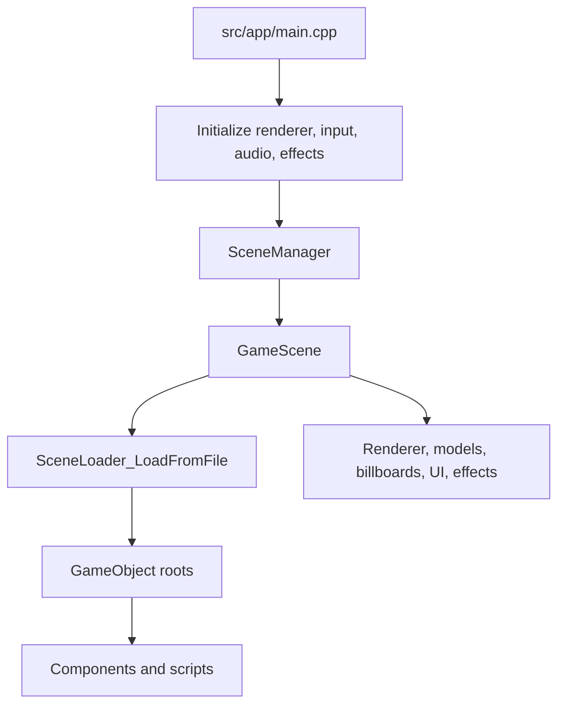

# Ivy Engine Manual

This file documents the reusable game engine in this repository. It is not a game design document and should not be treated as documentation for any one game built with the engine.

**New to the engine?** Read the human tutorial first: [`ENGINE_USER_GUIDE.md`](ENGINE_USER_GUIDE.md).  
**Need every function?** See [`ENGINE_API_REFERENCE.md`](ENGINE_API_REFERENCE.md).

This manual is written for both human developers and AI agents. Use it as a map from engine concepts to source files, public APIs, JSON fields, and expected runtime behavior.

## AI Agent Quick Reference

When asked to work on the engine, start here:

- Engine code lives in `engine/`.
- Application and runtime glue lives in `src/app/`.
- Content, assets, scenes, prefabs, and game scripts live in `rom/` and `game/scripts/`.
- Do not change game content or game-specific scripts unless the user asks for game behavior changes.
- Scene and prefab data are JSON files. Prefer preserving existing key names and component names exactly.
- Component serialization names are case-sensitive: `SceneTransform`, `visual`, `Billboard`, `Script`, `Collider`, `DirectionalLight`, `PointLight`, `SpotLight`, `Camera`, `Material`, `Effect`.
- User-authored scripts are loaded through the `GameScripts` DLL and referenced from JSON with `"scriptClass"`.
- Third-person play follow looks for objects tagged `TAG_PLAYER` (not a hard-coded script class name).
- UI buttons use builtin actions `LoadScene` / `ExitGame`, or a `UICanvasScript::OnClick` on the element — not game-specific engine binders.

Important source files:

- `engine/ecs/game_object.h`: scene object, hierarchy, components, lifecycle, collider helpers.
- `engine/ecs/tag_registry.h`: project tag name list (`rom/tags.json`), builtins + custom tags.
- `engine/ecs/component.h`: base component contract.
- `engine/ecs/component_factory.h`: JSON component-name registry.
- `engine/ecs/prefab_serializer.h`: recursive prefab node format.
- `engine/scene/scene_loader.h`: scene load/save, script DLL loading, runtime sync.
- `engine/editor/project_manager.h`: content project open/create/save, `project.json`, recent list.
- `engine/scripting/Script.h`: script base class.
- `engine/scripting/script_runtime_api.h`: script-facing host API.
- `engine/ui/ui_canvas.h`: scene UI container.
- `engine/rendering/d3d11/renderer.h`: D3D11 renderer lifecycle and viewport API.

## Engine Architecture

The repository contains an editor/application target, a runtime target, and a script DLL target.

- `IvyEngine.vcxproj` builds the main editor/application executable (`IvyEngine.exe`). It owns the windowed app target, shader build integration, editor GUI, and development-time runtime.
- `IvyEngineRuntime.vcxproj` builds the runtime host (`IvyEngineRuntime.exe`) with `GAME_RUNTIME` defined. Runtime builds reuse most engine and app code but replace editor GUI behavior with runtime shims.
- `game/scripts/GameScripts/GameScripts.vcxproj` builds user-authored game scripts into `GameScripts.dll`.
- `engine/` contains reusable engine systems: ECS, scene loading, scripting bridge, rendering, physics, UI, input, audio, effects, and editor helpers.
- `src/app/` contains the Windows entry point, game loop, scene manager integration, camera helpers, and the main `GameScene`.
- `rom/` contains runtime content such as scenes, prefabs, models, textures, effects, shader output, and default-scene configuration.
- `shaders/` contains HLSL source compiled by the project build.
- `libraries/` contains third-party dependencies such as ImGui, nlohmann JSON, DirectXTex, FBX SDK, and Effekseer.

Main runtime flow:



## Build And Runtime Entry Points

- `src/app/main.cpp`: Win32 entry point and main loop.
- `src/app/scene/scene_manager.h`: `SceneBase` and singleton `SceneManager`.
- `src/app/scene/game_scene.cpp`: central runtime scene. It initializes engine GUI/runtime GUI, scene loading, shadows, lighting, model cache, UI canvas, skybox, billboards, and per-frame update/draw passes.
- `engine/core/engine_gui.cpp`: editor-mode ImGui scene editor, play/stop control, prefab panels, selection, scene dirty state, project File menu, fixed-aspect game viewport, and script reload handling.
- `engine/core/engine_gui_runtime.cpp`: runtime replacement for editor GUI functions under `GAME_RUNTIME`.
- `engine/editor/project_manager.cpp`: Unity-style content projects (`project.json`, cwd switch, New/Open/Save, recent list).

## Content projects

A **content project** is a directory containing at least `rom/` and usually `project.json`. The editor sets the process working directory to that root so existing relative asset paths continue to work.

`project.json` schema (version 1):

| Field | Type | Meaning |
|-------|------|---------|
| `name` | string | Display name (window title) |
| `version` | int | Schema version (`1`) |
| `lastOpenedScene` | string | Scene file name restored on open |
| `defaultScene` | string | Default / play scene; mirrored to `rom/scene/default_scene.txt` |
| `editor.uiZoomPercent` | int | ImGui scale percent |

Recent projects are stored outside the content tree in `%AppData%/GameEngine/recent_projects.json`.

New Project scaffolds `rom/scene/scene_main.json`, copies engine builtins (`rom/shader`, `rom/font`, `rom/texture`) from the editor ship folder, and may copy `external_content_template` scripts when the engine repo is discoverable. See also [`CONTENT_PROJECT.md`](CONTENT_PROJECT.md) for deploy-oriented external repos.

## Editor viewport aspect

`engine/core/engine_gui.cpp` lays out a **fixed-aspect** game viewport (ratio from the original 1920×1080 chrome). The viewport fits inside the center region; left/right panels absorb letterbox gutters. Camera projection, shadows, Effekseer, and UI hit-tests use that viewport’s width÷height — not the full client area. There is no authored per-camera aspect field in render settings.

## ECS Object Model

Source files:

- `engine/ecs/game_object.h`
- `engine/ecs/component.h`
- `engine/ecs/component_factory.h`
- `engine/ecs/transform.h`

`GameObject` is the engine's scene object. It owns identity, hierarchy, components, legacy transform fields, physics state, collider state, activity state, and collision callbacks.

Important `GameObject` data:

- `m_position`, `m_rotation`, `m_scale`: legacy public transform fields.
- `m_isActive`: inactive objects skip update and draw.
- `m_tag`: integer id into the project `TagRegistry` (builtins match `enum class Tag`).
- `m_rigidbody`: per-object physics body.
- `m_collider`: optional runtime collider.
- `m_ignoreCollisionTags`: tag ids this object ignores.
- `m_name`: editor and serialization name.
- `m_prefabAssetPath`: source prefab path for round-trip serialization.
- `m_children`: owned child objects.
- `m_components`: owned components keyed by C++ type.

### Tag registry

Source: `engine/ecs/tag_registry.h`, file `rom/tags.json`.

Built-in names (stable indices, match `enum class Tag`):

- `NONE` (0), `SHADOW`, `GROUND`, `OBSTACLES`, `WALL`, `PLAYER`, `ENEMY`, `BULLET`, `SCLAP`
- `TAG_MAX` in C++ marks the end of builtins; custom tags append after this.

`rom/tags.json` shape:

```json
{ "tags": [ "NONE", "SHADOW", "GROUND", "…", "MyCustom" ] }
```

Rules:

- Names are trimmed; uniqueness is case-insensitive.
- Built-ins cannot be removed in the editor.
- Deleting a custom tag remaps open-scene objects and ignore lists (deleted → `NONE`, higher custom ids decrement), then saves `tags.json`.
- Scene/prefab JSON `"tag"` is the integer index, not the string name.

Legacy `enum class Tag` values (`TAG_NONE` … `TAG_SCLAP`, `TAG_MAX`) remain for scripts and collision helpers; they are the first entries of the registry.

Common `GameObject` functions:

- `GetName()`, `SetName()`
- `GetPrefabAssetPath()`, `SetPrefabAssetPath()`
- `AddComponent<T>()`
- `AddComponentRaw(std::unique_ptr<Component>)`
- `GetComponent<T>()`
- `HasComponent<T>()`
- `RemoveComponent<T>()`
- `GetComponents()`
- `GetParent()`, `SetParent()`, `AddChild()`, `GetChildren()`, `ReparentChild()`
- `Initialize()`, `Finalize()`, `Update(double)`, `Reset()`, `LogicUpdate(double)`, `IntegratePhysics(double)`, `Draw()`
- `OnCollision(GameObject*)`, `OnCollisionExit(GameObject*)`, `CanCollideWith(GameObject*)`
- `Translate()`, `SetActive()`, `IsActive()`
- `SetTag()`, `GetTag()`
- `SetPosition()`, `GetPosition()`, `SetRotation()`, `GetRotation()`, `SetScale()`, `GetScale()`
- `GetRigidbody()`, `GetCollider()`
- `GetTransform()`
- `SyncLegacyTransformFromComponents()`, `SyncComponentsFromLegacyTransform()`
- `DrawVisual(bool useRealModel)`
- `GetWorldPose()`
- `AddIgnoreCollisionTag()`, `ShouldIgnoreCollisionWith()`
- `CreateBoxCollider()`, `CreateSphereCollider()`, `CreateCapsuleCollider()`, `CreateCylinderCollider()`, `CreateMeshCollider()`
- `RefreshColliderData(Model3D&)`

`GameObject::Update()` order:

1. Return immediately when `m_isActive` is false.
2. Update all attached components with `Component::Update(elapsed_time)`.
3. Run legacy subclass logic through `LogicUpdate(elapsed_time)`.
4. Integrate physics with `IntegratePhysics(elapsed_time)`.
5. Recurse into children.

`GameObject::Reset()` calls `OnReset()` on all components, then recurses into children.

## Component Contract

All engine components inherit from `Component` in `engine/ecs/component.h`.

Required function:

```cpp
virtual const char* GetTypeName() const = 0;
```

Lifecycle hooks:

```cpp
virtual void OnAttach() {}
virtual void OnDetach() {}
virtual void Update(double elapsed_time) {}
virtual void OnReset() {}
```

Serialization and parameter hooks:

```cpp
virtual void SetParam(const std::string& key, const std::string& value) {}
virtual std::string Serialize() const { return "{}"; }
virtual void Deserialize(const std::string& json) {}
```

`Component::owner` points to the owning `GameObject`. It is set automatically by `GameObject::AddComponent()` and `GameObject::AddComponentRaw()`.

`ComponentFactory` maps component type-name strings to creator functions. Scene and prefab loading use this factory to instantiate components from JSON:

```cpp
ComponentFactory::Instance().Register("TypeName", [] {
    return std::make_unique<MyComponent>();
});
```

The `REGISTER_COMPONENT(TypeName)` macro registers a default-constructible component using its `GetTypeName()` value.

## Transform Component

Source file: `engine/ecs/transform.h`

`engine::Transform` is the canonical component transform for scene nodes.

Type name:

```cpp
"SceneTransform"
```

Fields:

- `localPosition`: local position.
- `localRotation`: local Euler rotation in degrees.
- `localScale`: local scale.

Functions:

- `OnAttach()`: snapshots the starting state.
- `OnReset()`: restores the last snapshotted starting state.
- `SnapshotStartState()`: updates the reset point after editor changes.
- `GetLocalMatrix()`
- `GetWorldMatrix()`
- `SetFromLocalMatrix(DirectX::XMMATRIX)`
- `Serialize()`
- `Deserialize()`

JSON keys:

```json
{
  "posX": 0.0,
  "posY": 0.0,
  "posZ": 0.0,
  "rotX": 0.0,
  "rotY": 0.0,
  "rotZ": 0.0,
  "scaleX": 1.0,
  "scaleY": 1.0,
  "scaleZ": 1.0
}
```

## Scene And Prefab Format

Source files:

- `engine/ecs/prefab_serializer.h`
- `engine/ecs/prefab_serializer.cpp`
- `engine/scene/scene_loader.h`
- `engine/scene/scene_loader.cpp`
- `engine/scene/render_settings.h`

Scene files and saved prefab files use a versioned wrapper. Prefab loading also accepts older bare-node files.

Scene wrapper:

```json
{
  "version": 4,
  "settings": {
    "render": {}
  },
  "nodes": [
    {
      "name": "GameObject",
      "tag": 0,
      "prefabAssetPath": "rom/prefabs/example.json",
      "components": {},
      "children": []
    }
  ],
  "canvas": {}
}
```

Recursive node keys:

- `name`: serialized object name. Defaults to `"GameObject"` on load.
- `tag`: integer index into `TagRegistry` / `rom/tags.json` (0 = `NONE`). Defaults to `TAG_NONE`.
- `prefabAssetPath`: optional path to the source prefab.
- `components`: object where each key is a component type name and each value is that component's JSON object.
- `children`: recursive array of child nodes.

`PrefabSerializer` functions:

- `Serialize(const GameObject& root)`
- `SaveToFile(const GameObject& root, const std::string& filePath)`
- `Deserialize(const std::string& json)`
- `LoadFromFile(const std::string& filePath)`

`SceneLoader` functions:

- `SceneLoader_GetSceneNodes()`
- `SceneLoader_StopScriptWatcher()`
- `SceneLoader_Initialize(bool enableScriptWatcher)`
- `SceneLoader_Finalize()`
- `SceneLoader_RegisterComponentTypes()`
- `SceneLoader_LoadScriptDlls()`
- `SceneLoader_UnloadScriptDlls()`
- `SceneLoader_ScanScriptDllsForChanges(bool forceReload)`
- `SceneLoader_DrainScriptReloadQueue(...)`
- `SceneLoader_GetDefaultScenePath()`
- `SceneLoader_GetCurrentScenePath()`
- `SceneLoader_LoadDefaultSceneSetting()`
- `SceneLoader_RefreshSceneAssets()`
- `SceneLoader_SetDefaultSceneFileName(...)`
- `SceneLoader_CopySceneFileName(...)`
- `SceneLoader_LoadFromFile(const char*)`
- `SceneLoader_SaveToFile(const char*)`
- `SceneLoader_ClearSceneNodes()`
- `SyncSceneRuntime()`
- `ClearSceneRuntime(bool destroyColliders = false)`
- `ApplyEditorColliders()`
- `RestoreEditorDebugColliderFlags()`
- `TeardownAllScripts()`
- `TeardownScenePlaySession(bool resetTransforms)`
- `DrawSceneModels()`
- `SceneLoader_IsSceneGraphObject(GameObject*)`
- `GameObjectFromLegacyBlock(...)`
- `SnapshotSceneStartTransforms()`
- scene browser helpers such as `SceneLoader_TryGetSceneAsset()`, `SceneLoader_GetSceneAssetCount()`, and `SceneLoader_ApplySceneAssetByIndex()`

## Registered Serializable Components

Component types are registered in `SceneLoader_RegisterComponentTypes()`.

### SceneTransform

Source: `engine/ecs/transform.h`

Purpose: local transform component for scene hierarchy and editor reset behavior.

JSON keys: `posX`, `posY`, `posZ`, `rotX`, `rotY`, `rotZ`, `scaleX`, `scaleY`, `scaleZ`.

### visual

Source: `engine/ecs/visual_component.h`

Purpose: model, proxy model, animation, glow, and shader override data.

Fields:

- `modelPath`
- `proxyModelPath`
- `playAnimation`
- `animationPaths`
- `activeClip`
- `emissionGlow`
- `shaderOverride`

Functions:

- `OnDetach()`
- `OnReset()`
- `Update(double)`
- `PlayClip(const std::string&)`
- `GetModel()`
- `GetRealModel()`
- `Serialize()`
- `Deserialize()`

JSON keys:

- `model`: primary model path.
- `proxy_model`: optional editor or paused-mode model path.
- `animate`: enables animation playback.
- `active_clip`: selected animation clip.
- `animations`: object mapping clip name to animation FBX path.
- `shader`: per-object shader override.

### Billboard

Source: `engine/ecs/billboard_component.h`

Purpose: declarative textured billboard visuals separate from model rendering.

Functions:

- `Serialize()`
- `Deserialize()`
- `GetTextureSRV()`
- `SubmitSceneBillboards(...)`

JSON keys:

- `texture`
- `sizeX`
- `sizeY`
- `color`: object with `r`, `g`, `b`, `a`.
- `rotation`
- `groundAligned`
- `enabled`

### Script

Source: `engine/scripting/script_component.h`

Purpose: attach a user-authored `Script` subclass by class name.

Functions:

- `OnAttach()`
- `OnDetach()`
- `Update(double)`
- `OnReset()`
- `Teardown()`
- `Serialize()`
- `Deserialize()`
- `GetScript()`
- `GetScriptClass()`
- `GetEditableProperties()`
- `ApplyProperties(...)`
- `HotReload()`

JSON keys:

```json
{
  "scriptClass": "MyScript",
  "properties": {}
}
```

### Collider

Source: `engine/ecs/collider_component.h`

Purpose: declarative collider setup for a `GameObject`.

Functions:

- `ApplyToOwner()`
- `ClearFromOwner()`
- `Serialize()`
- `Deserialize()`

JSON keys:

- `colliderType`: integer value from `ColliderType`.
- `colliderCenter`: object with `x`, `y`, `z`.
- `halfExtents`: object with `x`, `y`, `z`.
- `radius`
- `height`
- `meshSizePadding`
- `showDebugCollider`

Collider type values:

- `NONE`
- `BOX`
- `SPHERE`
- `CAPSULE`
- `MESH`
- `CYLINDER`

### DirectionalLight

Source: `engine/ecs/directional_light_component.h`

Purpose: directional scene light.

Functions:

- `Serialize()`
- `Deserialize()`
- `ComputeDirectionWS(const engine::Transform*)`

JSON keys: `enabled`, `color`, `intensity`, `specColor`, `specPower`, `castShadows`.

### PointLight

Source: `engine/ecs/point_light_component.h`

Purpose: positional point light.

Functions: `Serialize()`, `Deserialize()`.

JSON keys: `enabled`, `color`, `intensity`, `specColor`, `specPower`, `range`, `attenuation`.

### SpotLight

Source: `engine/ecs/spot_light_component.h`

Purpose: cone light with optional shadow casting.

Functions: `Serialize()`, `Deserialize()`.

JSON keys: `enabled`, `color`, `intensity`, `specColor`, `specPower`, `range`, `attenuation`, `innerAngleDeg`, `outerAngleDeg`, `castShadows`.

## Render Settings

Source: `engine/scene/render_settings.h`

Scene render settings live under `settings.render` in a scene JSON file.

Known fields:

- `skyboxEnabled`
- `skyboxCubemap`
- `skyboxTint`
- `skyboxExposure`
- `skyboxRotationYDeg`
- `clearColor`
- `defaultShader`

Use render settings for scene-level rendering defaults. Use `VisualComponent::shaderOverride` only for per-object overrides.

## Scripting Manual

Source files:

- `engine/scripting/Script.h`
- `engine/scripting/script_component.h`
- `engine/scripting/script_factory.h`
- `engine/scripting/script_register.h`
- `engine/scripting/script_dll_register.h`
- `engine/scripting/script_fields.h`
- `engine/scripting/script_runtime_api.h`

Scripts are game-specific C++ classes compiled into `GameScripts.dll`, but the script lifecycle and host API are engine-owned.

### Script Authoring Flow

1. Create a class that inherits from `Script`.
2. Implement `OnCreate(engine::GameObject& self)` for initialization.
3. Implement `OnUpdate(engine::GameObject& self, float dt)` for per-frame logic.
4. Optionally implement `OnDestroy(engine::GameObject& self)` for cleanup.
5. Optionally implement `Serialize()` and `Deserialize()` for persisted script properties.
6. Register the script once in its `.cpp` file with `REGISTER_SCRIPT(MyScript)`.
7. Attach the script from prefab or scene JSON with a `Script` component and `"scriptClass": "MyScript"`.

Minimal script shape:

```cpp
class MyScript : public Script {
public:
    void OnCreate(engine::GameObject& self) override;
    void OnUpdate(engine::GameObject& self, float dt) override;
    void OnDestroy(engine::GameObject& self) override;
};

REGISTER_SCRIPT(MyScript)
```

`Script` lifecycle:

- `OnCreate()`: called once after the script object is created and properties are deserialized.
- `OnUpdate()`: called every frame while the owner is active.
- `OnDestroy()`: called before script teardown.
- `GetRuntimePhysicsProxy()`: optional hook for scripts that use a separate runtime physics object.
- `Serialize()`: returns persisted script state as JSON.
- `Deserialize()`: restores persisted script state from JSON before `OnCreate()`.

### Script Serialized Fields

Use `script_fields.h` when a script has simple persisted fields.

```cpp
#define MY_SCRIPT_FIELDS(X) \
    X(float, moveSpeed, 5.0f) \
    X(int, count, 1)

class MyScript : public Script {
public:
    MY_SCRIPT_FIELDS(SCRIPT_DECLARE_FIELD)
    SCRIPT_SERIALIZE_METHODS(MY_SCRIPT_FIELDS)
};
```

Prefab JSON only needs `scriptClass` when C++ defaults are enough. Use `properties` for per-instance overrides.

### ScriptFactory

`ScriptFactory` maps script class names to creators.

Important functions:

- `Instance()`
- `Register(const std::string& name, Creator creator)`
- `Create(const std::string& name)`
- `IsRegistered(const std::string& name)`
- `IsDllScript(const std::string& name)`
- `SerializeScriptProperties(...)`
- `DeserializeScriptProperties(...)`
- `LoadScriptDll(...)`
- `UnloadScriptDll(...)`
- `UnloadAllDlls()`
- `RequestReload(...)`
- `PendingReloadCount()`
- `DrainReloadQueue(...)`
- `ReleaseRetiredDlls()`
- `InvokeExportOnLoadedDlls(...)`
- `ResolveDllExport(...)`

## Script Runtime API

Source: `engine/scripting/script_runtime_api.h`

`ScriptRuntimeApi` is the function-pointer table exposed by the host executable. Prefer using the `ScriptApi_*` wrapper functions instead of manually reading the table.

Scene and component helpers:

- `ScriptApi_GetCurrentScene()`
- `ScriptApi_FindTransform(engine::GameObject&)`
- `ScriptApi_FindTransform(const engine::GameObject&)`
- `ScriptApi_FindColliderComponent(engine::GameObject&)`
- `ScriptApi_FindVisualComponent(engine::GameObject&)`
- `ScriptApi_Visual_PlayClip(VisualComponent*, const char*)`

Collider helpers:

- `ScriptApi_ApplyColliderComponent(ColliderComponent&)`
- `ScriptApi_CreateBoxCollider(engine::GameObject&, DirectX::XMFLOAT3 size, DirectX::XMFLOAT3 center)`
- `ScriptApi_DestroyCollider(engine::GameObject&)`
- `ScriptApi_GetColliderWorldCenter(const Collider&)`
- `ScriptApi_GetBoxColliderSize(const BoxCollider&)`
- `ScriptApi_SetBoxColliderSize(BoxCollider&, DirectX::XMFLOAT3)`
- `ScriptApi_GetSphereColliderRadius(const SphereCollider&)`
- `ScriptApi_TryGetColliderFootprint(const Collider&, DirectX::XMFLOAT3&, DirectX::XMFLOAT3&)`

Camera, renderer, and sprite helpers:

- `ScriptApi_EngineGUIStopPlay()`
- `ScriptApi_CameraSetPosition(DirectX::XMFLOAT3)`
- `ScriptApi_CameraSetTarget(DirectX::XMFLOAT3)`
- `ScriptApi_CameraSetUp(DirectX::XMFLOAT3)`
- `ScriptApi_GetCameraForward()`
- `ScriptApi_GetBackBufferWidth()`
- `ScriptApi_GetBackBufferHeight()`
- `ScriptApi_SpriteDraw(...)`
- `ScriptApi_TextureGetWhiteTexture()`
- `ScriptApi_TextureGetWidth(int)`
- `ScriptApi_TextureGetHeight(int)`
- `ScriptApi_TextureRelease(int)`
- `ScriptApi_TextureLoad(const wchar_t*, bool mipmap = true)`
- `ScriptApi_TextureGetSRV(int)`

Scene loading and play control:

- `ScriptApi_EngineGUILoadFromFile(const char*)`
- `ScriptApi_EngineGUIStartPlay()`
- `ScriptApi_SceneCanvasRequestSceneFile(const char* sceneFile, bool playOnLoad)`

UI helpers:

- `ScriptApi_SceneCanvasGetCanvas()`
- `ScriptApi_SceneCanvasShowCountdown(int)`
- `ScriptApi_SceneCanvasShowCountdownText(const char*)`
- `ScriptApi_SceneCanvasHideCountdown()`
- `ScriptApi_SceneCanvasSetTimerSeconds(float)`
- `ScriptApi_UICanvasAddSprite(...)`
- `ScriptApi_UICanvasRemoveElement(UICanvas&, const char*)`
- `ScriptApi_UISpriteSetTexture(UISprite&, const wchar_t*)`
- `ScriptApi_UICanvasGetSprite(UICanvas&, const char*)`
- `ScriptApi_UISpriteSetRadial360Fill(UISprite&, float, bool clockwise = true)`
- `ScriptApi_UISpriteSetFillNone(UISprite&)`
- `ScriptApi_UICanvasGetElement(UICanvas&, const char*)`
- `ScriptApi_UITextSetText(UIText&, const char*)`
- `ScriptApi_UIElementSetVisible(UIElement&, bool)`
- `ScriptApi_PickupDebugSetMessage(const char*, float displaySeconds = 4.0f)`

Billboard, lock-on, debug, and prefab helpers:

- `ScriptApi_BillboardAdd(...)`
- `ScriptApi_LockOnUI_SetTarget(GameObject*, bool onMagnetCooldown = false)`
- `ScriptApi_DebugDrawSphereWire(...)`
- `ScriptApi_PrefabInstantiate(const char*, DirectX::XMFLOAT3, DirectX::XMFLOAT3 rotation = {}, GameObject* parent = nullptr, bool startActive = true)`
- `ScriptApi_PrefabDestroy(GameObject*)`
- `ScriptApi_PrefabSetBeforeDestroyCallback(void (*callback)(GameObject*))`

Input functions are exposed through the host table for keyboard, mouse, and controller state. Scripts commonly reach these through wrappers or direct table use depending on the local script pattern.

## Rendering And Assets

Source files:

- `engine/rendering/d3d11/renderer.h`
- `engine/rendering/d3d11/shader.h`
- `engine/rendering/model/model.h`
- `engine/rendering/sprite/texture.h`
- `engine/rendering/sprite/sprite.h`
- `engine/rendering/billboard/billboard.h`
- `engine/ecs/model_asset_cache.h`

Renderer lifecycle and frame functions:

- `InitRenderer(HINSTANCE, HWND, BOOL)`
- `UninitRenderer()`
- `Clear()`
- `Present()`

D3D11 device access:

- `GetDevice()`
- `GetDeviceContext()`

Viewport and window functions:

- `SetDepthEnable(bool)`
- `GetBackBufferWidth()`
- `GetBackBufferHeight()`
- `GetClientWidth()`
- `GetClientHeight()`
- `Renderer_ClientToBackbuffer(...)`
- `Renderer_BackbufferToClient(...)`
- `Renderer_UpdateClientSize()`
- `Renderer_ResizeToClient()`
- `Renderer_SetWindowMode(BOOL)`
- `Renderer_IsWindowed()`
- `SetRenderViewport(...)`
- `ResetRenderViewport()`
- `GetRenderViewportWidth()`
- `GetRenderViewportHeight()`
- `GetWindowHandle()`

Important rendering data:

- `VERTEX_3D`: position, normal, diffuse color, texture coordinate.
- `MATERIAL`: ambient, diffuse, specular, emission, shininess. It is 16-byte aligned for constant buffers.

`VisualComponent` uses `ModelAssetCache` so many objects can share loaded GPU model resources. Use `VisualComponent::GetModel()` for editor or paused mode and `GetRealModel()` for play mode.

## Physics And Collision

Source files:

- `engine/physics/core/rigidbody.h`
- `engine/physics/core/physics_system.h`
- `engine/physics/collider/collider.h`
- `engine/ecs/collider_component.h`

`Rigidbody` is stored directly on `GameObject` as `m_rigidbody`. `GameObject::IntegratePhysics()` moves non-kinematic objects using this body.

Collider hierarchy:

- `Collider`: base class with owner, local center, trigger flag, world center, collision interface, and debug draw.
- `BoxCollider`: full-size box collider.
- `SphereCollider`: radius collider.
- `CapsuleCollider`: radius and height collider.
- `CylinderCollider`: vertical Y-axis radius and height collider.
- `MeshCollider`: triangle mesh collider built from `Model3D`.

Collider functions:

- `GetType()`
- `SetOwner()`, `GetOwner()`
- `SetCenter()`, `GetCenter()`
- `SetIsTrigger()`, `IsTrigger()`
- `GetWorldCenter()`
- `CheckCollision(const Collider*)`
- `ResolveCollision(Collider*)`
- `DebugDraw(...)`

Shape-specific functions include `SetSize()`, `GetSize()`, `SetRadius()`, `GetRadius()`, `SetHeight()`, `GetHeight()`, `SetMeshData()`, `BuildFromModel()`, `SetSizePadding()`, `GetWorldBoundingSphereRadius()`, `GetWorldAABB()`, and `Raycast()`.

Prefer `ColliderComponent` for JSON-authored colliders. Use `GameObject::Create*Collider()` or `ScriptApi_CreateBoxCollider()` for runtime-created colliders.

## Input

Source files:

- `engine/input/keyboard.h`
- `engine/input/key_logger.h`
- `engine/input/mouse.h`
- `engine/input/controller.h`

Keyboard:

- `Keyboard_Keys` defines virtual-key-like values prefixed with `KK_`.
- `Keyboard_State` and `Keyboard_*` functions provide current keyboard state.
- `key_logger.h` is used for trigger-style key detection.

Controller:

- `ControllerButton` maps to XInput buttons.
- `Controller_Initialize()`
- `Controller_Finalize()`
- `Controller_Update()`
- `Controller_IsConnected(int padIndex = 0)`
- `Controller_IsPressed(ControllerButton, int padIndex = 0)`
- `Controller_IsTrigger(ControllerButton, int padIndex = 0)`
- `Controller_IsRelease(ControllerButton, int padIndex = 0)`
- `Controller_GetLeftStick(int padIndex = 0)`
- `Controller_GetRightStick(int padIndex = 0)`
- `Controller_GetLeftTrigger(int padIndex = 0)`
- `Controller_GetRightTrigger(int padIndex = 0)`
- `Controller_SetStickDeadzone(short left, short right)`
- `Controller_SetTriggerDeadzone(BYTE trigger)`
- `Controller_SetVibration(float leftMotor, float rightMotor, int padIndex = 0)`

## UI System

Source files:

- `engine/ui/ui_element.h`
- `engine/ui/ui_canvas.h`
- `engine/ui/ui_sprite.h`
- `engine/ui/ui_text.h`
- `engine/ui/ui_button.h`
- `engine/ui/ui_bar.h`
- `engine/ui/scene_canvas.h`

`UIElement` is the base class for overlay UI.

Anchors:

- `TOP_LEFT`
- `TOP_CENTER`
- `TOP_RIGHT`
- `CENTER_LEFT`
- `CENTER`
- `CENTER_RIGHT`
- `BOTTOM_LEFT`
- `BOTTOM_CENTER`
- `BOTTOM_RIGHT`

`UIElement` functions:

- `Initialize()`
- `Update(double)`
- `Draw()`
- `Finalize()`
- `SetVisible(bool)`, `IsVisible()`
- `SetPosition(...)`, `GetPosition()`
- `SetAnchor(...)`, `GetAnchor()`
- `GetName()`, `SetName(...)`
- `GetScreenPosition()`
- `GetScreenPosition(float screenWidth, float screenHeight)`
- `UIGetLayoutScale()`

`UICanvas` owns and orders UI elements for a scene.

`UICanvas` functions:

- `Initialize()`
- `Update(double)`
- `Draw()`
- `Finalize()`
- `AddButton(...)`
- `AddSprite(...)`
- `AddBar(...)`
- `AddText(...)`
- `AddElement(std::unique_ptr<UIElement>)`
- `ClearElements()`
- `RemoveElement(const std::string&)`
- `RemoveElement(UIElement*)`
- `MoveElement(...)`
- `MoveElementForward(...)`
- `MoveElementBackward(...)`
- `MoveElementToFront(...)`
- `MoveElementToBack(...)`
- `GetElement(const std::string&)`
- `EnableNavigation(bool)`
- `IsNavigationEnabled()`
- `SelectButton(int)`
- `SelectNextButton()`
- `SelectPreviousButton()`
- `GetSelectedButtonIndex()`
- `GetSelectedButton()`
- `GetName()`
- `GetElementCount()`
- `GetButtonCount()`
- `GetElements()`
- `SetVisible(bool)`

`scene_canvas.h` provides the shared scene UI canvas used by scenes and scripts:

- `SceneCanvas_Initialize()`
- `SceneCanvas_Finalize()`
- `SceneCanvas_Update(double)`
- `SceneCanvas_Draw()`
- `SceneCanvas_GetCanvas()`
- `SceneCanvas_ClearSceneCanvas()`
- `SceneCanvas_LoadSceneCanvas(const nlohmann::json&)`
- `SceneCanvas_SaveSceneCanvas()`
- `SceneCanvas_RegisterButtonAction(...)`
- `SceneCanvas_BindButtonAction(UIButton*)`
- `SceneCanvas_RequestSceneFile(const std::string&, bool playOnLoad = false)`
- `SceneCanvas_ConsumeRequestedSceneFile(bool*)`
- `SceneCanvas_ShowCountdown(int)`
- `SceneCanvas_ShowCountdownText(const char*)`
- `SceneCanvas_HideCountdown()`
- `SceneCanvas_ShowRedOverlay()`
- `SceneCanvas_HideRedOverlay()`
- `SceneCanvas_SetRedOverlayAlpha(float)`
- `SceneCanvas_SetTimerSeconds(float)`

Scene JSON may contain a top-level `canvas` object. The loader passes it to scene canvas loading when present; otherwise it clears the scene canvas.

Scene canvas element types:

- `sprite`
- `text`
- `button`
- `bar`

Common canvas item keys:

- `type`: one of the element types above.
- `name`: element lookup name.
- `position`: 2D element position.
- `anchor`: string matching a `UIAnchor` value.

Common type-specific keys:

- `sprite`: `size`, `texture`, sprite color and fill fields when supported by the sprite implementation.
- `text`: `text`, `color`, `fontSize`, alignment fields when supported by the text implementation.
- `button`: `size`, `text`, `textScale`, `color`, action binding fields when supported by the button implementation.
- `bar`: `label`, `currentValue`, `maxValue`, color and size fields when supported by the bar implementation.

## Audio

Source file: `engine/audio/audio_manager.h`

`AudioManager` is a singleton for XAudio2 and X3DAudio playback.

Audio types:

- `BGM`
- `SFX`
- `VOICE`

Lifecycle and listener:

- `AudioManager::Instance()`
- `Initialize()`
- `Finalize()`
- `Update()`
- `SetListener(const DirectX::XMFLOAT3& position, const DirectX::XMFLOAT3& forward, const DirectX::XMFLOAT3& up)`
- `SetListener(GameObject*)`

Playback and loading:

- `PlayBGM(id, path, volume, loop)`
- `PlaySFX(id, path, volume, loop)`
- `PlayVoice(id, path, volume)`
- `LoadBGM(id, path)`
- `PlayBGM(id, volume, loop)`
- `LoadSFX(id, path)`
- `PlaySFX(id, volume, loop)`
- `LoadVoice(id, path)`
- `PlayVoice(id, volume)`
- `PlaySFX3D(id, path, position, volume, loop)`
- `Load3DSFX(id, path)`
- `PlaySFX3D(id, volume, loop)`

Control, emitter, volume, and debug:

- `Stop(id)`
- `StopAll()`
- `StopAllByType(AudioType)`
- `IsPlaying(id)`
- `SetEmitterPosition(id, position)`
- `SetEmitterDistanceScale(id, scale)`
- `SetEmitter(id, GameObject*)`
- `SetListenerStereoBalance(bool)`
- `SetVolume(id, volume)`
- `SetMasterVolume(volume)`
- `SetBGMVolume(volume)`
- `SetSFXVolume(volume)`
- `SetVoiceVolume(volume)`
- `SetDebugDraw(bool)`
- `DrawDebug()`
- `GetDebugInfo(...)`

When using object-tracking listener or emitter functions, the referenced `GameObject` must remain valid while audio uses it.

## Effects

Source files:

- `engine/rendering/effect/effect_object.h`
- `engine/rendering/effect/effect_system.h`

`EffectObject` is a `GameObject` subclass for Effekseer-backed effects.

Important functions:

- `SetAutoDestroyOnEnd(bool)`
- `GetAutoDestroyOnEnd()`
- `SetAutoPlay(bool)`
- `GetAutoPlay()`
- `SetSpeed(float)`
- `SetPaused(bool)`
- `SetShown(bool)`
- `Play()`
- `Stop()`
- `LoadFromFileW(const wchar_t*)`
- `SetEffectId(int)`
- builder-style helpers such as `WithEffectId()`, `WithPosition()`, `WithRotation()`, `WithScale()`, `WithAutoPlay()`, and `WithAutoDestroyOnEnd()`
- `AttachToCurrentScene()`
- `InitNow()`
- `PlayNow()`
- `StopNow()`
- `Speed(float)`
- `Paused(bool)`
- `Shown(bool)`
- `SpawnW(...)`
- overridden `Initialize()`, `Finalize()`, `LogicUpdate(double)`, `Draw()`

Global effect functions:

- `Effect_Initialize()`
- `Effect_Finalize()`
- `Effect_Update(double elapsed_time)`
- `Effect_Draw()`

## Editor And Runtime Split

The engine has editor and runtime modes.

Editor mode:

- Uses `engine/core/engine_gui.cpp`.
- Provides ImGui controls, scene graph interaction, prefab panels, asset selection, play/stop controls, and hot reload behavior.

Runtime mode:

- Defines `GAME_RUNTIME`.
- Uses `engine/core/engine_gui_runtime.cpp`.
- Loads the default or requested scene and enters play behavior without exposing editor panels.

Avoid adding game-specific logic to editor/runtime split code. Game-specific behavior belongs in scripts or content unless the engine API itself is being extended.

## Recommended Change Rules For Agents

- Prefer editing engine code only when the request names engine behavior.
- Preserve JSON component names and field names unless the user explicitly wants a migration.
- When adding a serializable component, update registration in `SceneLoader_RegisterComponentTypes()` and document its `GetTypeName()` and JSON fields here.
- When adding script host functions, update `ScriptRuntimeApi`, the host function table, wrapper functions, and this manual.
- When changing scene or prefab schema, update `PrefabSerializer`, `SceneLoader`, examples in `rom/`, and this manual.
- When adding script fields, prefer `SCRIPT_DECLARE_FIELD` and `SCRIPT_SERIALIZE_METHODS` for simple property bags.
- Keep engine docs separated from game docs. Use game files only as examples of how the engine is consumed.

